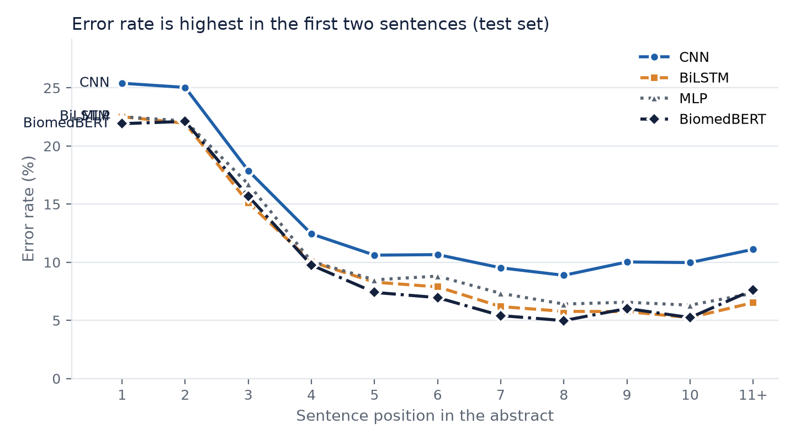

# Error analysis

Full test set (29,578 sentences): CNN, BiLSTM, MLP, BiomedBERT. Shared 200-abstract sample (2,328 sentences): CNN, BiLSTM, MLP, BiomedBERT, GPT sentence 0-shot, GPT abstract 3-shot.

## 1. What kind of errors

### Full test set

**CNN**: 4,032 errors in 29,578 sentences (13.6%); Background ↔ Objective = 1,286 (32% of errors)

| True → predicted | Errors | Share |
|---|---:|---:|
| Objective → Background | 875 | 22% |
| Results → Methods | 800 | 20% |
| Background → Objective | 411 | 10% |
| Conclusions → Results | 381 | 9% |
| Results → Conclusions | 339 | 8% |
| Methods → Results | 316 | 8% |

**BiLSTM**: 3,028 errors in 29,578 sentences (10.2%); Background ↔ Objective = 1,313 (43% of errors)

| True → predicted | Errors | Share |
|---|---:|---:|
| Objective → Background | 941 | 31% |
| Results → Methods | 475 | 16% |
| Background → Objective | 372 | 12% |
| Methods → Results | 348 | 11% |
| Conclusions → Results | 289 | 10% |
| Results → Conclusions | 210 | 7% |

**MLP**: 3,229 errors in 29,578 sentences (10.9%); Background ↔ Objective = 1,304 (40% of errors)

| True → predicted | Errors | Share |
|---|---:|---:|
| Objective → Background | 807 | 25% |
| Results → Methods | 542 | 17% |
| Background → Objective | 497 | 15% |
| Methods → Results | 323 | 10% |
| Conclusions → Results | 305 | 9% |
| Results → Conclusions | 277 | 9% |

**BiomedBERT**: 3,008 errors in 29,578 sentences (10.2%); Background ↔ Objective = 1,204 (40% of errors)

| True → predicted | Errors | Share |
|---|---:|---:|
| Objective → Background | 815 | 27% |
| Results → Methods | 465 | 15% |
| Background → Objective | 389 | 13% |
| Conclusions → Results | 345 | 11% |
| Methods → Results | 234 | 8% |
| Results → Conclusions | 166 | 6% |

### LLM sample

**GPT sentence 0-shot**: 232 errors in 2,328 sentences (10.0%); Background ↔ Objective = 123 (53% of errors)

| True → predicted | Errors | Share |
|---|---:|---:|
| Objective → Background | 63 | 27% |
| Background → Objective | 60 | 26% |
| Results → Methods | 45 | 19% |
| Methods → Results | 20 | 9% |
| Background → Methods | 10 | 4% |
| Conclusions → Results | 8 | 3% |

**GPT abstract 3-shot**: 186 errors in 2,328 sentences (8.0%); Background ↔ Objective = 124 (67% of errors)

| True → predicted | Errors | Share |
|---|---:|---:|
| Objective → Background | 63 | 34% |
| Background → Objective | 61 | 33% |
| Results → Methods | 39 | 21% |
| Methods → Objective | 6 | 3% |
| Methods → Results | 4 | 2% |
| Methods → Conclusions | 3 | 2% |

## 2. Background vs Objective

In the 2,500 test abstracts, 51% contain a Background sentence, 63% an Objective sentence and only 14% both. The first sentence is Background in 50% of abstracts and Objective in 50%. Which label the opening sentences get depends largely on whether the authors used a 'Background' or an 'Objective' heading.

| Model | Objective → Background | …in abstracts with no Background | Background → Objective | …in abstracts with no Objective |
|---|---:|---:|---:|---:|
| CNN | 875 | 89% | 411 | 90% |
| BiLSTM | 941 | 90% | 372 | 96% |
| MLP | 807 | 90% | 497 | 88% |
| BiomedBERT | 815 | 94% | 389 | 95% |
| GPT sentence 0-shot | 63 | 100% | 60 | 97% |
| GPT abstract 3-shot | 63 | 100% | 61 | 100% |

## 3. Where in the abstract

| Position | CNN error % | BiLSTM error % | MLP error % | BiomedBERT error % | Sentences |
|---|---:|---:|---:|---:|---:|
| 1 | 25.4 | 22.5 | 22.5 | 21.9 | 2,500 |
| 2 | 25.0 | 22.0 | 22.2 | 22.1 | 2,500 |
| 3 | 17.9 | 15.1 | 16.7 | 15.7 | 2,500 |
| 4 | 12.4 | 10.0 | 10.1 | 9.8 | 2,500 |
| 5 | 10.6 | 8.3 | 8.5 | 7.4 | 2,497 |
| 6 | 10.7 | 7.9 | 8.8 | 7.0 | 2,486 |
| 7 | 9.5 | 6.2 | 7.3 | 5.4 | 2,457 |
| 8 | 8.9 | 5.8 | 6.4 | 5.0 | 2,388 |
| 9 | 10.0 | 5.8 | 6.6 | 6.0 | 2,224 |
| 10 | 10.0 | 5.2 | 6.3 | 5.2 | 1,965 |
| 11+ | 11.1 | 6.5 | 7.3 | 7.6 | 5,561 |

## 4. Do the models fail on the same sentences? (LLM sample)

| Models wrong | Sentences | Share |
|---|---:|---:|
| 0 | 1866 | 80.2% |
| 1 | 140 | 6.0% |
| 2 | 78 | 3.4% |
| 3 | 48 | 2.1% |
| 4 | 36 | 1.5% |
| 5 | 40 | 1.7% |
| 6 | 120 | 5.2% |

Sentences every model gets wrong, by true label: Objective 58, Results 33, Background 23, Methods 5, Conclusions 1

Of these 120, 112 get the same wrong label from every model, a hint that the gold label rather than the models may be the odd one out.

Random examples (predictions in the order CNN, BiLSTM, MLP, BiomedBERT, GPT sentence 0-shot, GPT abstract 3-shot):

| Pos | Gold | Predicted | Sentence |
|---|---|---|---|
| 2/8 | Results | Methods / Methods / Methods / Methods / Methods / Methods | Seventy-five patients were randomly assigned to one of four diets for @ wk : high-saturated fatty acids ( HSFAs ) , high-MUFA ( HMUFA ) , and two low-fat , high-complex carbohydrate ( LFHCC ) diets supplemented with l... |
| 2/11 | Objective | Background / Background / Background / Background / Background / Background | Two such solutes , indoxyl sulfate and p-cresol sulfate , have been associated with adverse outcomes in renal failure . |
| 4/11 | Results | Methods / Methods / Methods / Methods / Methods / Methods | The effect of n-@ PUFA ( EPA : DHA = @:@ ; @ M EPA plus @ M DHA ) was tested on CAC/EPC viability , function ( tube-formation ) and pro-inflammatory molecule expression . |
| 3/10 | Background | Methods / Methods / Methods / Methods / Methods / Methods | This prospective randomized placebo-controlled multicenter trial is designed to evaluate the efficacy of ferric carboxymaltose administration with the primary end point of successful hemoglobin level increase by @ g/d... |
| 3/19 | Objective | Conclusions / Background / Background / Background / Background / Background | This may have serious implications for the safety of individuals operating motor vehicles . |
| 5/11 | Methods | Results / Results / Results / Results / Results / Results | The expected CIN rate was similar for the two groups ( @ % versus @ % , p = @ ) . |
| 3/11 | Objective | Background / Background / Background / Background / Background / Background | Cranberry products have been associated with urinary tract health . |
| 7/13 | Results | Methods / Methods / Methods / Methods / Methods / Methods | Costs were calculated by utilizing the extensive data on resource consumption , from the DANPACE trial . |
| 1/12 | Objective | Background / Background / Background / Background / Background / Background | Nocturnal periodic breathing occurs more frequently in men than in women with various clinical and pathophysiologic conditions . |
| 3/14 | Results | Background / Background / Background / Methods / Methods / Methods | This study was part of a randomized clinical trial titled Rural Education to Improve Outcomes in Heart Failure ( REMOTE-HF ) designed to test an education and counseling intervention to improve self-care in patients w... |

## 5. Scores with Background and Objective merged

### Full test set

Same predictions, scored again after treating Objective and Background as one class (4 classes). Nothing is retrained.

| Model | Sentences | 5-class accuracy | 5-class macro-F1 | Merged accuracy | Merged macro-F1 |
|---|---:|---:|---:|---:|---:|
| CNN | 29,578 | 86.4 | 80.9 | 90.7 | 90.6 |
| BiLSTM | 29,578 | 89.8 | 84.5 | 94.2 | 94.4 |
| MLP | 29,578 | 89.1 | 84.1 | 93.5 | 93.7 |
| BiomedBERT | 29,578 | 89.8 | 84.6 | 93.9 | 93.7 |

### LLM sample

| Model | Sentences | 5-class accuracy | 5-class macro-F1 | Merged accuracy | Merged macro-F1 |
|---|---:|---:|---:|---:|---:|
| CNN | 2,328 | 86.5 | 80.9 | 91.0 | 91.0 |
| BiLSTM | 2,328 | 88.8 | 83.1 | 93.9 | 94.3 |
| MLP | 2,328 | 88.3 | 82.9 | 93.1 | 93.5 |
| BiomedBERT | 2,328 | 89.7 | 84.3 | 94.1 | 94.2 |
| GPT sentence 0-shot | 2,328 | 90.0 | 84.1 | 95.3 | 95.7 |
| GPT abstract 3-shot | 2,328 | 92.0 | 85.8 | 97.3 | 97.7 |
